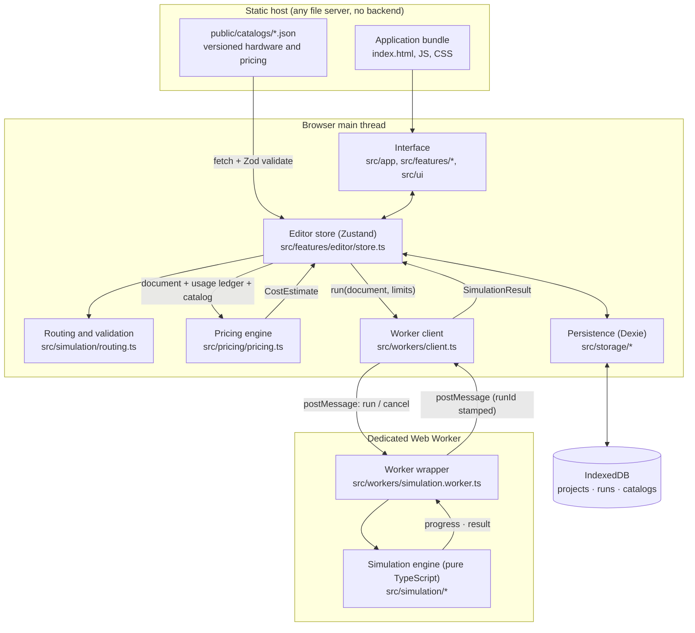
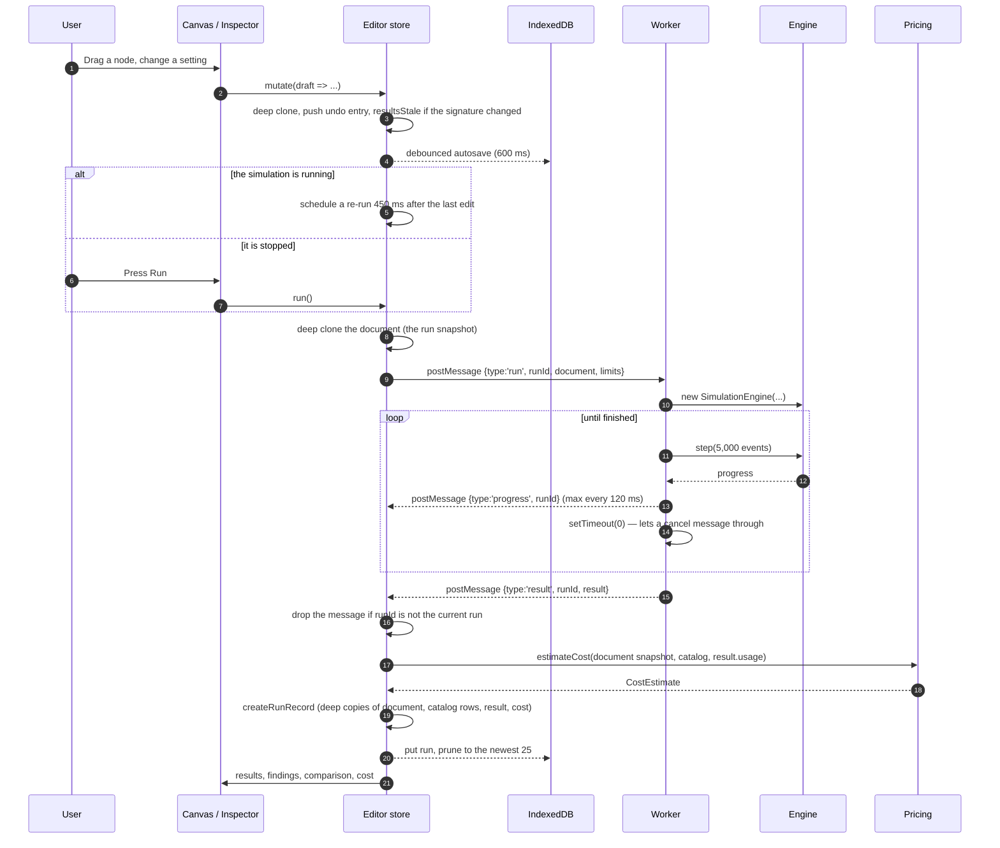
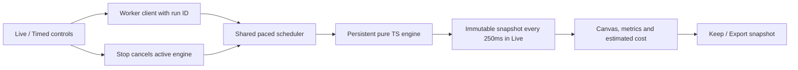

# Aparecium — Architecture

This describes the architecture **as it is actually implemented**. Anything not
yet built is in [future.md](future.md), never here. The chronological record of
how it got this way is in [decisions.md](decisions.md).

---

## 1. The whole system at a glance



Everything runs in the browser. There is no application backend, no account
system, no external database, no paid API, no AI, and nothing is provisioned
anywhere. The static host does exactly two things: serve the bundle and serve
the catalog JSON files.

---

## 2. Responsibilities

| Part | Files | What it is responsible for | What it must never do |
|---|---|---|---|
| **Domain** | `src/domain/` | The serialisable shapes everything shares (components, connections, workload, project), the Zod schemas, unit formatting, defaults and starter templates. | Know about React, the DOM, storage, or the engine. |
| **Interface** | `src/app/`, `src/features/*/`, `src/ui/` | Draw the canvas, the settings panels, the results and the cost breakdown. Translate gestures into document edits. Own the light/dark theme. | Contain simulation or pricing arithmetic. |
| **Editor store** | `src/features/editor/store.ts` | Hold the open project, the selection, the undo history, the catalogs, the run state. Orchestrate save, run, import and export. | Be the source of truth for anything React Flow owns. |
| **Routing / validation** | `src/simulation/routing.ts` | Build the graph, resolve one unambiguous operation path per client, and explain in plain language when it cannot. | Guess at what an ambiguous drawing meant. |
| **Simulation engine** | `src/simulation/` | Discrete-event simulation of the resolved routes. | Import React, the DOM, IndexedDB, or any worker API. |
| **Worker wrapper** | `src/workers/` | Drive the engine in chunks, report progress, honour cancellation, stamp every message with a run id. | Contain simulation logic. |
| **Pricing engine** | `src/pricing/pricing.ts` | Turn provisioned resources + a usage ledger + a catalog into an explained monthly estimate. | Share state with the event engine, or use binary floats for money. |
| **Catalogs** | `src/catalogs/`, `public/catalogs/` | Versioned static JSON: hardware profiles and cloud rates, validated at load and cached. | Present an unverified number as a provider's price. |
| **Storage** | `src/storage/` | Projects, immutable run snapshots, catalog cache, import/export. | Let an edit to a project change a saved run. |

### Dependency rule

Dependencies point **downwards** only:

```
app / features / ui
        ↓
   storage · pricing · workers
        ↓
      catalogs
        ↓
     simulation
        ↓
       domain
```

`src/simulation/**` imports only from `src/domain/**` and itself. That is what
makes the engine testable in plain Node and reusable inside a worker. The one
place the arrow points the other way is `src/catalogs/loader.ts`, which uses
`src/storage/db.ts` for its cache; loading is an application concern, not a
domain one, so this is deliberate.

### Interface layout

The canvas fills the viewport. Everything else floats over it as a card, and
each can be put away:

```
+-------------------------------------------------------------------+
| [menu] Aparecium | project name | saved      [theme] [panel]      |
|                                                                   |
|                                              +------------------+ |
|            (canvas: the whole viewport)      | Components |     | |
|                                              |  Settings        | |
|   [Users]--[Application Server]--[Database]  |  search          | |
|                                              |  [ ] [ ] [ ] [ ] | |
|   +---------------------------------------+  +------------------+ |
|   | completed 1,334 | 39.88 ms | $675.96/mo |                     |
|   | Summary Components Journeys Cost Compare|                     |
|   +---------------------------------------+                       |
|   | [Run] 66.7/s  For 20s  Drain 10s  Seed |                      |
+-------------------------------------------------------------------+
```

- **Top left** — menu (projects, import, export), wordmark, project name, save
  indicator, undo and redo.
- **Top right** — theme toggle and side-panel toggle.
- **Right** — one card holding either the palette or the settings for the
  selection. Selecting anything on the canvas switches it to Settings.
- **Bottom** — the control bar (Run, offered load, duration, drain, seed,
  validation chip), with the results sheet stacked above it.
- **Results sheet** — three states: absent until a run exists, a one-line strip
  of headline numbers, or expanded with the five tabs.

Because the panels sit *over* the canvas rather than beside it, the canvas has
to know which parts of itself are covered. `App.tsx` measures the bottom stack
with a `ResizeObserver` and passes that plus the panel width to `Canvas`, which
frames the diagram in the uncovered band (see ADR-014).

### Theming

Every colour is a CSS custom property defined twice in `src/app/styles.css`:
once on `:root` (light) and once on `:root[data-theme="dark"]`. Tailwind maps
semantic names onto those variables, so a component writes `bg-surface` or
`text-ink-2` and never names a hue. `src/app/theme.ts` owns the choice: light
is the default, an explicit choice is remembered in `localStorage`, and the
theme is applied before React renders so there is no flash. The theme is a
browser preference, not project data — it never reaches a saved project, an
export or a run snapshot.

---

## 3. Data flow: from editing a design to a saved result



---

## 4. Key structures

### Architecture document (`src/domain/types.ts`)

```ts
{
  schemaVersion: 1,
  nodes: [{ id, kind, name, position, cloud: { profileId }, settings }],
  edges: [{ id, source, target, settings: { propagationDelayMs, bandwidthMbps } }],
  workload: { durationSeconds, drainSeconds, seed, arrivalPattern: 'constant' },
  pricingOverrides: { [profileId]: { compute?, storage?, egress? } }
}
```

`kind` is `client | server | database | cache` and discriminates `settings`.
Everything is plain JSON: no classes, no functions, no cyclic references, so it
survives `structuredClone`, IndexedDB and `JSON.stringify` unchanged.

### Run record (`src/storage/db.ts`)

```ts
{
  id, projectId, createdAt, label, schemaVersion,
  engineVersion, seed,
  inputDocument,     // deep copy — never a reference to the live document
  catalogSnapshot,   // only the catalog rows this document referenced
  result,            // the full SimulationResult
  cost               // the CostEstimate produced from it
}
```

### Worker messages (`src/workers/protocol.ts`)

```ts
// to the worker
{ type: 'run',  runId, document, limits }
{ type: 'cancel', runId }
// from the worker
{ type: 'progress', runId, progress: { fraction, simulatedMs, eventsProcessed, completed } }
{ type: 'result',   runId, result }
{ type: 'error',    runId, message }
```

### Catalog profile (`public/catalogs/cloud-profiles.v1.json`)

```jsonc
{
  "id": "aws.ec2.m7i-large.us-east-1",
  "appliesTo": ["server"],
  "verified": false,
  "priceSourceUrl": "...", "priceCheckedAt": "2026-09-09", "priceNote": "...",
  "charges": {
    "compute": { "unit": "instance-hour", "amount": "0.10" },
    "egress":  { "unit": "GB", "amount": null, "note": "why there is no rate" }
  }
}
```

A charge that is **absent** does not apply. A charge with `amount: null`
applies but has no known rate. Neither is ever treated as zero.

---

## 5. What the simulation actually models

**Approach:** average service costs plus simple resource contention and queues,
executed as a discrete-event simulation. Simulated time advances by jumping to
the timestamp of the next scheduled event. Real timers are used only to yield
between chunks, never for individual events.

### Routing rules

A connection means "these two can talk". It never broadcasts. At run time the
graph is walked and each group of users must resolve to exactly one *entry
point*, which is either a single server or a load balancer with a pool behind
it:

1. `Users → Server`
2. `Users → Server → Database`
3. `Users → Server` with `Server → Cache` and `Server → Database` (cache-aside)
4. `Users → Load Balancer → many Servers`, each with its own optional cache and
   database
5. Any server may also publish to one `Message Queue`, which is drained by one
   Application Server behind it — with its own optional cache and database
6. In front of the entry point, any number of **edge components** in any order
   — `CDN`, `WAF`, `API Gateway` — each forwarding to exactly one thing:
   `Users → CDN → WAF → API Gateway → Load Balancer → …`
7. Beside the path, at most one `DNS` per group of users: `Users → DNS`. It is
   consulted, never traversed.
8. A `Serverless Function` stands wherever an `Application Server` may: entry
   point, balancer target, queue or topic consumer. The two are one compute
   model with different knobs (see ADR-026).
9. A server may also call one `Key-Value Store` and one `Object Storage` — one
   operation per request, read or write by a configured share — and publish to
   one `Pub/Sub Topic`, which hands a copy to every consumer behind it.
10. A `Database` replicates to any number of `Read Replicas`; a server reads
    from the replicas of its own database and writes to the database, and the
    database copies every write to every replica, asynchronously.

An edge component is a service station with one reason of its own to stop a
request. The **CDN** answers a sampled share as hits and sends the response
straight back; only misses go on, so everything behind it sees a fraction of
the load. The **WAF** inspects everything and refuses a sampled share as
`waf-blocked`. The **API gateway** keeps a token bucket — refilled at the rate
limit, holding at most the burst allowance — and refuses what finds no token as
`gateway-throttled`, on the spot, never queued. All three forward what they let
through one link onward, and responses walk the same chain back. **DNS** gates
the *start* of a request: the configured share of requests ask it first, wait
for the answer, then set off; the rest already know the address. None of the
four computes, and none is a server.

The load balancer is the only component that fans out, and it is modelled as a
service station like the database and the cache: N slots, an average forwarding
time, a bounded queue. It forwards; it never computes. Its cost is charged once
on the way in, and the response passes back through it without queueing again.
Which server receives a request is decided by the configured policy — round
robin, or the server holding the fewest requests, with ties going to the lowest
index so runs stay reproducible.

Anything else is refused with an explanation and a hint — a hop that forwards
to nothing, to two things, or back into the chain, and users tied to more than
one DNS, each have their own message. Multiple clients may share the same
server, database, cache and edge components.

### Asynchronous work

A message queue is the one place where work outlives the request that created
it. The publishing server waits only for the broker to accept the message and
then answers its own caller; the consumer takes messages off the backlog
whenever it has room for another. That is the trade a queue exists to make, and
the price of it — a backlog that grows when the consumer cannot keep up — is
reported as the number of messages still waiting when the run ended.

A queue is two things. The **broker** is a service station like the database: N
slots, an average time to accept a message, a bounded waiting line. The
**backlog** is separate, and is a plain FIFO with a depth limit; a publish beyond
that limit is refused, so the request fails rather than the message vanishing.

Not modelled: retries, dead-letter queues, acknowledgement timeouts, ordering
guarantees, partitions, or more than one consumer per queue.

### How traffic arrives

Four shapes, set on the workload and applying to every client sending at a
steady rate:

| Pattern | What it does | Random? |
|---|---|---|
| Steady | Evenly spaced at the configured rate | No |
| Random | Exponential gaps with the same mean (Poisson arrivals) | Yes |
| Ramp | Rate moves from one multiple of the configured rate to another | No |
| Bursty | A raised rate for part of every period | No |

Only Poisson draws random numbers, and it draws them from a stream of its own so
that adding it cannot shift what any other component sees. Ramp and burst read
the rate in force at the moment a request is created, which is exact for a burst
and a first-order approximation for a ramp.

A client can also be **closed-loop**: a fixed population where each user waits
for its own response, thinks for a while, and only then sends again. The offered
rate is then an outcome rather than a setting — there can never be more requests
in flight than there are users, so a system that slows down is asked for less,
which is what a real crowd does. Results report the ceiling and the achieved
rate separately.

The cache-aside sequence: the server checks the cache; a hit returns the value;
a miss reads the database; if cache population is on, the server writes the
value back and **waits for the acknowledgement**; then the response goes to the
client. Responses travel back over the reverse direction of the same link.

### Resource model

| Resource | Held from | Released at | Notes |
|---|---|---|---|
| CPU slot | start of a compute segment | end of that segment | Released while waiting on a database or cache. |
| Application concurrency | admission | when the response is handed to the network | Includes requests that are only waiting. |
| Memory (MB, a number) | admission or queueing | same as concurrency | `baseline + admitted × perRequest + queued × perQueued`. |
| Database / cache slot | when service starts | when service ends | Bounded queue in front of it. |
| Link channel (one per direction) | when transmission starts | when the last bit is sent | Bounded by nothing but the event limits; queue length is measured. |

CPU work per request is divided evenly across the compute segments between
downstream calls, so the total CPU cost per request does not change with the
number of calls, but the slot is genuinely given back during a wait. This is
what makes "more CPU helps a CPU-bound server, more RAM alone does not" true in
the model rather than merely asserted.

Admission and rejection: a request is admitted if a concurrency slot is free
*and* memory allows. Otherwise it queues, if the queue has room *and* memory
allows. Otherwise it is rejected, with the reason recorded
(`server-queue-full`, `server-memory-full`, `database-queue-full`,
`cache-queue-full`).

### Network model

One message transmits per direction at a time. Transfer time is
`bytes × 8 / (Mbps × 1000)` milliseconds; then the one-way propagation delay is
added. There is no congestion control, no packet loss, no windowing, no
retransmission and no TCP or QUIC behaviour of any kind.

### Randomness

One seeded generator per named stream (`cache-hit:<cacheId>`), derived from the
run seed and an FNV-1a hash of the stream name. Cache hit or miss is sampled once, as soon as the
server that will handle the request is known — at creation when there is no
balancer, and at the moment the balancer picks a server when there is one. Because the hit probability is a fixed
constant, that is distributionally identical to sampling at lookup time, and it
lets the engine know up front how many compute segments the request needs.

### Limits and incomplete runs

`DEFAULT_LIMITS` in `src/domain/types.ts`: 500,000 pending events, 200,000
in-flight requests, 5,000,000 processed events, 8 sampled request journeys.
Hitting one stops the run, labels it `incomplete`, and states in plain language
which limit was reached and what that means for the numbers.

### Approximation boundaries — what is *not* modelled

Operating system scheduling; database query planning, indexes, transactions or
replication; individual cache keys, expiry, LRU or LFU; TCP/QUIC; browser
cookies, sessions or rendering; autoscaling, serverless or background workers;
per-language or per-framework performance; protocol comparisons. Of the edge:
what a CDN caches, which requests a firewall would actually flag, TLS
termination, DNS TTLs and resolver hierarchies — the hit, block and lookup
shares are assumptions, and are labelled as such. Stored data size affects storage cost only — it does not change
query time, because no model here connects the two.

---

## 6. How pricing works

The pricing engine takes provisioned resources (from the document), a usage
ledger (from a run, or nothing), and a catalog, and returns a line-by-line
monthly estimate.

- **Compute** — `rate × 730 hours`. Fixed. An idle, disconnected component still
  costs this.
- **Storage** — `rate × dataSizeGb` for a database, `rate × capacityGb` for a
  cache. Fixed.
- **Outbound transfer** — measured bytes leaving a component towards a client
  are divided by the run's measured seconds to get a rate, then multiplied by
  2,628,000 seconds (730 hours). A short run and a long run at the same traffic
  rate produce the same monthly number; a run total is never simply scaled up.

All arithmetic uses `decimal.js` with `ROUND_HALF_UP`. Line amounts are shown
to two decimal places; the total is the sum of the unrounded line amounts,
rounded once at the end. A missing rate produces an **unpriced** line that is
excluded from the total and carries the reason it has no rate.

The panel lists what is included and what is excluded (IOPS, backups, load
balancers, cross-zone traffic, replicas, commitments, support, tax, and so on),
the currency, the catalog date, and per-profile source URLs and check dates.

**No rate in Aparecium is a verified provider price.** On 2026-09-09 the
official AWS and Google Cloud pricing pages were fetched and neither exposes
its figures as page text. Every profile is therefore marked
`"verified": false`, uses deliberately round placeholder amounts, and is
editable in the interface; edits are stored in the document as
`pricingOverrides` and travel with export, import and run snapshots.

---

## 7. Persistence, versioning and import/export

Three IndexedDB collections via Dexie (`src/storage/db.ts`):

- `projects` — keyed by `id`, indexed on `name` and `updatedAt`.
- `runs` — keyed by `id`, indexed on `projectId` and `createdAt`. Newest 25 per
  project are kept.
- `catalogs` — keyed by catalog id; a cached copy of each fetched file.

**Autosave** is debounced at 600 ms with a visible status (Unsaved changes →
Saving… → Saved, or Save failed). A failed save never discards in-memory work;
the message points at Export. Writes are serialized and project switches flush
pending edits first. A switch is stopped if the save fails, keeping the project
available for export. Deletion clears its pending autosave before removing it.

**Undo/redo** keeps up to 60 document snapshots each way. A drag is one undo
step: intermediate position changes are applied non-undoably and a single entry
is captured on drag start and committed on drag stop.

**Transactions** — deleting a project deletes its runs inside one Dexie
read-write transaction, so it cannot half-succeed. Import also saves the new
project and its run history in one transaction.

**Versioning** — three independent version numbers:

| Version | Where | Meaning |
|---|---|---|
| `DOCUMENT_SCHEMA_VERSION` | `src/domain/types.ts` | Shape of an architecture document. |
| `EXPORT_FORMAT_VERSION` | `src/domain/schema.ts` | Shape of the export envelope. |
| Catalog `version` | each catalog file | Shape of that catalog. |

An import whose version is **higher** than this build understands is refused
with a message saying so and telling the user to update Aparecium. Older
documents are migrated forward by the Zod schema's defaults — for example a
document saved before rate editing existed gets `pricingOverrides: {}` rather
than failing validation. The Dexie schema is declared with `.version(1)`;
future changes add a `.version(n).upgrade()` block rather than dropping data.

**Import** always creates a *new* project (named "… (imported)") so an existing
project is never overwritten. Files over 20 MB are refused. A saved run that
cannot be validated is skipped with a note rather than failing the whole
import. `src/storage/run-schema.ts` validates nested results, cost rows and
catalog snapshots, including their supported schema versions. The limit is
measured in UTF-8 bytes. Imported runs receive new globally unique IDs so they
cannot overwrite the source project's history; the newest 25 are retained.

Restored and completed results are compared with the current document to derive
stale status. Switching projects cancels and detaches an active run, so a late
result cannot populate the new project's results panel.

---

## 8. Error handling and cancellation

Worker crashes and unreadable messages reject outstanding run promises and
enable the existing main-thread fallback for the next run. Missing catalogs
produce explicit unpriced component rows; a zero priced subtotal is never
presented as a complete free configuration. Outbound projection uses the same
monthly-hours input as compute charges.

- **Validation before running.** Errors block the Run button and are listed with
  a hint. Warnings (an unreachable component, a cache with no database) do not
  block; the design still runs.
- **Cancellation.** The worker processes ~12 ms of events, then yields with
  `setTimeout(0)`. Only a macrotask boundary lets a queued `cancel` message be
  delivered, which is why a microtask would not do. On cancel the engine stops
  and the partial result is returned, labelled `cancelled`, and measured against
  the simulated time it actually reached.
- **Stale results.** Every message carries a `runId`. The client settles the
  promise of a superseded run so nothing hangs, but only forwards progress for,
  and only clears the active slot for, the current run. The store additionally
  drops any result whose `runId` is no longer current.
- **Worker unavailable.** If a `Worker` cannot be constructed the client falls
  back to the same chunked loop on the main thread. Runs still work and are
  still cancellable.
- **Catalog unavailable.** Simulation continues; cost estimation is disabled and
  the reason is shown.
- **Storage unavailable.** The app runs entirely in memory and says so, pointing
  at Export.
- **Execution limits.** A run that hits one is labelled `incomplete` with a
  finding that explains which limit and why the numbers are partial.

---

## 9. Architecture decisions

Each has a stable ID and points at the `decisions.md` entry that records when
and why it happened.

### ADR-001 — The simulation engine is pure TypeScript, wrapped by a worker
**Status:** accepted. **Entries:** 005, 006, 011.
The engine imports nothing but `src/domain`. The worker is a thin driver.
*Why:* it can be unit tested in Node with no DOM shim, run inline when a worker
is unavailable, and reused later on a server if that ever becomes useful.
*Alternative:* putting the loop inside the worker file would have coupled the
model to the worker API and made the acceptance tests need a worker harness.
*Trade-off:* a small amount of plumbing in two files instead of one.

### ADR-002 — Discrete events in a binary min-heap, ordered by (time, sequence)
**Status:** accepted. **Entry:** 005.
*Why:* O(log n) for both insert and next-event, and an explicit tiebreaker so
two events at the same simulated millisecond always run in the same order.
*Alternative:* re-sorting a pending array is O(n log n) per event; a plain FIFO
cannot order events scheduled for different times at all.
*Trade-off:* without the sequence number, results would not be reproducible,
which would sink acceptance check 1.

### ADR-003 — CPU work is split into segments; concurrency and memory are not
**Status:** accepted. **Entry:** 006.
A request gives back its CPU slot while waiting downstream, but keeps its
concurrency slot and its memory.
*Why:* it is the single most important thing to get right for the product's
purpose. It is what makes adding CPU help a CPU-bound server and adding RAM
alone not.
*Trade-off:* splitting the average CPU cost evenly across segments is an
approximation. The total per request is preserved and the assumption is shown
in every run's assumptions list.

### ADR-004 — The cache outcome is sampled at request creation
**Status:** accepted. **Entry:** 006.
*Why:* the number of compute segments must be known before the first segment
starts. For a fixed hit probability, sampling at creation and sampling at
lookup have the same distribution.
*Alternative:* sampling at lookup time would need the CPU budget to be revised
mid-request.
*Trade-off:* if a future version makes the hit rate depend on traffic, this has
to move. Recorded in `future.md`.

### ADR-005 — A resource profile means the machine, and only the machine
**Status:** accepted, amended by ADR-023. **Entries:** 004, 047.
Choosing Small/Medium/Large sets CPU slots, memory and baseline memory. It does
not touch CPU work per request, the concurrency limit or per-request memory.
*Why:* those describe the application, not the machine. Conflating them would
make "more RAM did not help" impossible to demonstrate honestly.
*Trade-off:* a user who expects a bigger box to also raise concurrency has to
change that themselves. The panel says the profile is hardware only.
*Amended:* the profile now also carries the machine's *price*, which is part of
the machine rather than part of the application. See ADR-023.

### ADR-006 — Money is `Decimal`; a missing rate is "unpriced", never zero
**Status:** accepted. **Entry:** 010.
*Why:* `0.10 × 730` must be `73.00`, not `73.00000000000001`, and reporting an
unknown rate as free would be a lie that compounds across a whole estimate.
*Alternative:* floats with display rounding — rejected because the error is in
the total, not just the display.

### ADR-007 — Monthly projections scale a measured rate, not a run total
**Status:** accepted. **Entry:** 010.
*Why:* multiplying a 20-second total by "the number of 20-second blocks in a
month" is the same arithmetic but invites nonsense when the run length changes.
A test asserts that doubling the run length at the same traffic rate leaves the
monthly number identical.

### ADR-008 — A rate is either verified from a machine-readable source or labelled illustrative
**Status:** accepted, amended by ADR-024. **Entries:** 009, 052.
*Originally:* the official pricing pages render their tables with JavaScript,
so no figure could be read, and recalling prices from memory would present
invented values as provider prices. Every rate was a labelled placeholder.
*Amended:* the providers also publish machine-readable price lists, two of them
openly. AWS and Azure rates are now read from those and marked verified; Google
Cloud's stay illustrative until an API key is supplied. The rule that survives
is the label: nothing is ever presented as a provider price unless it was read
from the provider.
*Trade-off:* a verified rate is exact on its publication date and drifts after
it, which is why the date travels with the rate and a check command exists.

### ADR-024 — The catalog is generated, not edited
**Status:** accepted. **Entry:** 052.
`scripts/refresh-cloud-prices.mjs` is the only writer of
`cloud-profiles.v1.json`. It streams the AWS bulk CSVs (the EC2 file is ~300 MB
and is aborted once the wanted rows are seen), queries the Azure API, and
writes every rate with the provider's publication date. Which machines exist,
their ids and their `sizeClass` are a judgement recorded in the script.
*Why:* a price copied by hand is right on the day it is copied and quietly
wrong afterwards. A generated file can be checked against the source
(`--check`) and refreshed in one command.
*Consequence:* profile ids are stable across refreshes, so saved documents keep
their assignments and simply see current rates.
*A provider's counting rule lives on the charge:* `unitsPerOperation` on the
queue charge says that AWS bills three requests per message. The engine counts
messages and knows nothing about billing; the catalog states the rule; the
pricing engine applies it and prints it on the line.

### ADR-009 — The architecture document is the single source of truth for the canvas
**Status:** accepted. **Entry:** 012.
React Flow's nodes and edges are derived from the document; gestures are
translated back into document edits.
*Alternative:* letting React Flow own its state and syncing — rejected because
undo, autosave, export and validation would each need their own sync path.
*Trade-off:* a full document clone per edit, and a new object handed to React
Flow for every node. Documents are small (hundreds of nodes at most), so the
cloning has not been a problem — but the fresh objects were: React Flow discards
a node's measured handle positions when it is given a node without a `measured`
size, and an edge whose endpoints have no handle positions renders as nothing,
so every edit unmounted and remounted every connection. The nodes now declare
the size the card is fixed at. Entry 042.

### ADR-010 — A run keeps deep copies of everything it depended on
**Status:** accepted. **Entry:** 010.
*Why:* a run is evidence. If it held a reference to the live document, editing
the canvas would rewrite history.
*Trade-off:* a run record is larger. Runs are pruned to the newest 25 per
project.

### ADR-011 — The measurement interval depends on how the run ended
**Status:** accepted (supersedes the original single rule). **Entry:** 013.
A run that finished normally is measured over at least the configured arrival
window, so a slow trickle is not reported as a high rate. A run that was
cancelled or stopped at a limit is measured over the simulated time it actually
reached, because the window never elapsed.
*Why:* the original rule made a cancelled 20,000-second run report 0.92
requests per second, dividing real work by time that never happened.

### ADR-012 — Panels float over a full-bleed canvas
**Status:** accepted (supersedes the original three-column layout). **Entries:** 012, 018.
The canvas fills the viewport; the palette, settings, control bar and results
all float above it and can be dismissed.
*Why:* the first layout gave the canvas the smallest share of the screen, which
is backwards for a tool whose purpose is manipulating that canvas.
*Alternative:* widening the columns — rejected, because the columns themselves
were the problem.
*Trade-off:* floating panels cover part of the canvas, so the canvas has to be
told what is covered. ADR-014 is the consequence.

### ADR-013 — Colour is a role, expressed as a CSS custom property
**Status:** accepted. **Entry:** 018.
Two value sets, one on `:root` and one on `:root[data-theme="dark"]`; Tailwind
maps semantic names onto them.
*Why:* with two themes, any component that names a hue is a future bug. Naming
roles makes it structurally impossible for one theme to drift from the other.
*Alternative:* Tailwind's `dark:` variant on every colour utility — that doubles
every class and is easy to forget on one of them.
*Trade-off:* opacity modifiers (`bg-accent/10`) do not work on plain hex
variables, so tinted backgrounds are explicit `-soft` colours instead. That also
lets the dark theme choose a tint that actually reads on a dark ground.

### ADR-014 — The canvas frames the diagram in its *visible* area
**Status:** accepted. **Entries:** 019, 020.
`FitToVisibleArea` in `src/features/editor/Canvas.tsx` computes the viewport
from the document's node positions and a fixed node size, against the width and
height not covered by the side panel and the bottom stack.
*Why:* React Flow's `fitView` centres in the whole container, which put
components underneath the floating panels.
*Why not React Flow's own measurements:* `useNodesInitialized()` never becomes
true in this app, because `onNodesChange` deliberately drops everything except
position changes, so a controlled flow never records that its nodes were
measured. Accepting the dimension changes would mean a second source of truth
for node state, which ADR-009 exists to avoid.
*Trade-off:* the node box size is a constant shared between the CSS and the
arithmetic. Declaring it once in `Canvas.tsx` keeps the two from drifting.
*Note:* `setViewport` is silently dropped if given a transition before React
Flow has built its pan/zoom instance, so the fit is applied without one.

### ADR-015 — The load balancer is a service station, not a kind of server
**Status:** accepted. **Entry:** 036.
A Load Balancer is a `StationModel`, the same shape as a database and a cache:
N slots, an average service time, a bounded queue. It forwards a request to one
of the servers behind it and never computes anything.
*Why:* modelling it as a special server would have given it CPU slots, a memory
budget and a CPU utilisation figure, none of which mean anything for a
component that does no work. Reusing the station keeps its results honest — it
reports what it forwarded and how long anything waited, and nothing else.
*Consequence:* it is the first component that fans out, so the routing rule
became "one unambiguous *entry point* per group of users", and a route now
carries a list of server branches instead of a single server.
*Trade-off:* the response passes back through without queueing again, so a
balancer that is a bottleneck on the return path is not modelled. Stated in
every run's assumptions.

### ADR-016 — Cache outcomes are sampled when the server is known
**Status:** accepted (refines ADR-004). **Entry:** 036.
The cache hit draw and the CPU segment budget are settled as soon as the server
that will handle a request is known: at request creation when there is no
balancer, and at the moment the balancer picks a server when there is one.
*Why:* ADR-004 sampled at creation because the segment count has to be known
before the first compute segment. With a pool, *which* cache a request will
consult is not known until a server is chosen — so the decision moves to that
point, which is still before any compute.
*Consequence:* runs without a balancer are numerically unchanged, which is why
every earlier test kept its exact expected values.
*Trade-off:* two places now call the same preparation step. It is one function,
called from two well-defined moments.

### ADR-017 — A component's result lives on the component
**Status:** accepted. **Entry:** 036.
After a run, each node on the canvas shows a status dot, a utilisation bar and
one line of its own detail; the results sheet opens as a headline strip rather
than expanded.
*Why:* the sheet answers "how did the system behave"; standing in front of a
diagram, the question is usually "how did *this box* behave". Expanding the
sheet by default covered the very diagram those answers belong to.
*Consequence:* `SimulationResult` gained `clients`, so a design with several
groups of users can attribute results correctly — a component must never show
another component's numbers.
*Trade-off:* the node card grows a row when it has a result. Nodes therefore
carry an explicit `width` and `height` (see ADR-014), so React Flow never has
to measure a card whose size changed.

### ADR-018 — The editor re-runs itself, but only a person makes history
**Status:** accepted. **Entry:** 041.
An edit that changes what a simulation would do schedules a run 450 ms later.
That run is marked `automatic`: it is displayed, badged **Live**, replaced by
the next automatic run, and never written to IndexedDB. Pressing **Run
simulation** produces a kept run, which is what the Compare tab draws on.
*Why the split:* history is finite (25 runs per project) and exists so a change
can be measured against a baseline. Writing every automatic run into it would
bury that baseline within a minute of tweaking, breaking the feature the
automation was meant to serve.
*What counts as a change:* `simulationSignature` in
`src/simulation/signature.ts` — component settings, cloud profile, connections,
workload and rate overrides. Positions and names are excluded, because neither
can change a number; re-running on every frame of a drag would be absurd.
*Trade-off:* an automatic run is lost on reload, which is correct — it was a
preview of a design that is still on the canvas and can be re-run instantly.
*Alternative:* relying on the run cap to discard old automatic runs. Rejected:
the cap discards the oldest, which is exactly the baseline worth keeping.
*Superseded in part by ADR-019:* the split is unchanged, but a preview is now
promoted to history by **Keep** rather than by pressing Run a second time.

### ADR-019 — The simulation is a state a person starts and stops
**Status:** superseded by ADR-029. **Entry:** 044.
`live` says whether the system on the canvas is running: traffic moving, every
change picked up and re-simulated. It is distinct from `running`, which means a
worker call is in flight and is over in a fraction of a second — far too brief
for a button to reflect. **Run simulation** starts it, the same button reads
**Stop simulation** until pressed, and stopping also cancels a run in flight.
*Why:* a simulator that halts on every edit and needs a button press to resume
is not a simulation of anything; and a control bound to a sub-second worker call
never appears to toggle at all.
*What follows from it:* traffic flows while live and stops when stopped, nothing
else interrupts it; the last result stays on the components until a newer one
replaces it, with the "Earlier configuration" badge carrying the honesty; and a
design that cannot be simulated leaves the simulation live rather than freezing
it silently, with the problems chip explaining why no newer numbers arrive.
*Trade-off:* the numbers on the components can be up to a second behind the
canvas, and stay behind for as long as a validation error stands. The badge says
so. The alternative — blanking them — was what made the app look broken.
*Replaces:* the **Auto** switch, which meant "re-run after every change" and was
a second control for the same state.

### ADR-020 — A queue's consumer is an Application Server, not a new component
**Status:** accepted. **Entry:** 045.
A background worker is an application server whose input arrives from a queue:
the same CPU slots, concurrency limit and memory budget, and it needs a database
in the same way. A separate `worker` kind would duplicate `ServerSettings`,
`ServerModel` and the branch resolver.
*Consequence:* a worker inherits every rule a user-facing server follows, and
gets its own cache and database for free.
*Trade-off:* the component is called "Application Server" on a canvas where it is
doing background work. Renaming the node is the answer, and the queue's own
settings panel says what the arrangement means.
*Alternative:* a `worker` kind — rejected as the same one-thing-two-names problem
removed in entry 043.

### ADR-021 — A job is a request that starts at a queue and ends when it is done
**Status:** accepted. **Entry:** 045.
Rather than a second entity travelling its own path, each queue compiles to a
*consumer route*: the existing pipeline entered from the queue instead of from a
client, and finished instead of answered. The queue-to-worker link carries the
message forward and the acknowledgement back.
*Why:* the alternative added a branch for jobs to every handler in the engine.
*Consequence:* the one genuinely new mechanism is pull-based dispatch — work sits
still until a consumer with room comes for it, which is what lets a backlog grow.
*Trade-off:* jobs appear in the routes array beside clients, so anything summing
across routes has to say which kind it means.

### ADR-022 — Metered requests are a fourth kind of charge
**Status:** accepted. **Entry:** 045.
A managed queue has nothing to provision; the whole bill is what passed through
it, which none of compute, storage or egress describes. `ChargeType` gained
`requests`, priced per million and projected from the measured rate exactly as
egress is.
*Why not price it as compute:* it would put an hourly rate on something with no
instance, which is an invented number in the shape of a real one.
*Trade-off:* one more charge type in the catalog, the rate editor and the import
schema.

### ADR-023 — A hardware size carries its price, within its provider and region
**Status:** accepted. **Entry:** 047.
Picking Small/Medium/Large sets the cloud profile too, choosing the machine of
that size offered by the provider and region already selected. Cloud profiles
declare a `sizeClass` so the mapping lives in the catalog rather than in code.
*Why:* the previous rule — set capacity, leave the cost choice alone, point out
the mismatch — meant an upgrade to Large kept the price of a Medium, and the
estimate described a machine that was not being simulated. A mismatch nobody
acts on is not a safeguard, it is a wrong number with a footnote.
*Three outcomes, deliberately distinct:* `matched` takes the same-size machine
from the same provider and region; `keep` leaves a size-agnostic profile such as
self-managed hardware alone, because a size change says nothing about it; `none`
clears the rates so the component reports as **unpriced**, which is true, rather
than keeping a price for a machine nobody selected.
*What it must never do:* cross a provider or a region. Google having a large
machine is not a reason to move an AWS component to Google.
*Trade-off:* a provider with a gap in its range — Google has nothing small in
this catalog — sends a component to unpriced. The document retains the last
profile as `cloud.previousProfileId`, so returning to a supported size restores
pricing within the original provider and region, even after reload or import.
*Custom hardware (entries 049, 050):* priced as the smallest catalogued machine
in the same provider and region that has at least the CPU slots and memory typed
in. Hardware bigger than anything catalogued is priced as the largest machine
there is and **marked as a floor** on the cost line, in the warnings and in the
panel — reporting it as unpriced dropped the line from the total and made a
bigger machine look cheaper. Scaling a rate by slot count was rejected as an
invented price; a simulated slot is not a core.
*Unchanged:* manual cloud selection still wins and is never overwritten by
anything but a hardware change made with pricing set to automatic, and every
rate stays labelled illustrative.

*Amended in entry 048:* matching now runs through `normaliseServerPricing` on
editor mutations, project open and import, rather than only in the dropdown.
Older preset-based projects are repaired and saved on open. Their historical
run snapshots stay untouched and are marked stale when the current price changes.
An explicit cloud selection records `cloud.pricingMode: 'manual'`, preserving
the choice across reload and import. The mismatch callout offers **Use matching
rates**; selecting a hardware preset also restores automatic matching. Custom
hardware retains its manually chosen rates. Older documents did not record
manual intent, so a preset with a mismatched price is treated as automatic.

### ADR-026 — A serverless function is the server model with the platform's knobs
**Status:** accepted. **Entry:** 055.
A function is a `ServerModel` shaped by `shapeOfFunction`: a CPU slot per
invocation up to the concurrency limit, memory per invocation equal to what
was allotted, no waiting line at all. Over the limit is refused as
`function-throttled`; a sampled share of invocations pay a cold start before
their first CPU segment; and the model clocks the wall-clock time each
invocation is alive, which is what the provider bills as gigabyte-seconds.
*Why one model:* everything a server can be attached to — cache, database,
replica, stores, queue, topic — and everything it can stand behind — balancer,
edge chain, queue, topic — works for a function without a line of new code,
and the routing rules name one compute kind in every place they used to name a
server. *What the model says that a platform does:* nothing queues, capacity is
the limit, and waiting on a store costs money because the invocation is alive
while it waits.

### ADR-027 — Reads and writes are drawn once, and stores that bill them apart count them apart
**Status:** accepted. **Entry:** 055.
A database's `readShare`, a key-value store's `readShare` and object storage's
`writeShare` are sampled per request from a stream of their own, at the moment
the branch is known. A read goes to a replica when one is connected and to the
primary otherwise; a write always goes to the primary and is then copied to
every replica of that database — the database's business, not the caller's,
so a worker that reads from no replica still has its writes copied. A cache hit
answers a database read and a key-value read; it never answers a write. The
pricing engine gained two charge types: `writes`, so a store's read and write
rates stay the provider's own, and `duration`, for compute billed by the
gigabyte-second. *Trade-off:* the shares are assumptions and say so; nothing
here knows what a request asks for.

### ADR-028 — A topic is a queue with one backlog per listener
**Status:** accepted. **Entry:** 055.
A `Pub/Sub Topic` reuses the queue machinery — a broker station for publishes
and `QueueModel` backlogs — with the backlog keyed by topic *and* consumer, so
each listener has its own line and its own consumer route. A publish is
acknowledged once the broker has it; a copy then goes into every backlog, and
a full one drops its copy and counts it on the topic. The publisher is never
told. *Why:* that is what decouples a topic — a slow listener loses events
rather than slowing the publisher — and a design that shows the dropped count
teaches it. A queue keeps exactly one consumer; fan-out is what a topic is for.

### ADR-025 — Edge components are hops in front of the entry point; DNS is beside it
**Status:** accepted. **Entry:** 053.
A CDN, a WAF and an API gateway are service stations chained between the users
and whatever the entry point is, in any order and any number, each forwarding
to exactly one thing. A route records the chain and a `relayBack` map, so a
response retraces the same links. Each hop has one reason of its own to stop a
request — a hit answered at the edge, a block, a token bucket that says no —
and that reason is the whole point of the component. DNS is not a hop: a
request that needs a lookup asks it and waits before setting off, and the
share that needs one is a setting.
*Why a chain and not a fixed order:* real systems put these in different orders
— WAF inside the CDN, gateway in front of the balancer or behind it — and none
of the three cares what is next to it. The walk stops at the first thing that
is not an edge kind, so the existing entry-point rules apply unchanged behind
them.
*Why DNS is beside the path:* every request does not resolve a name; the
user's machine caches the answer. Making DNS a hop would charge every request
a lookup, which is wrong by a factor of fifty at the default share. The cost of
being beside the path is that the share is an assumption, and it says so.
*Why the gateway refuses rather than queues:* that is what a rate limit is for.
A gateway that queued the excess would be a load balancer with a delay.
*What is charged:* every request through a CDN, a WAF or a gateway is a billed
request, hit or miss, allowed or blocked; a CDN hit's bytes to the user are
the CDN's egress, so the balancer's egress falls when a CDN is put in front.
The rates are verified from the providers' price lists like the rest, and each
profile's note says which fixed monthly charges — hosted zones, WAF rules — are
not modelled.
*Trade-off:* the hit, block and lookup shares model nothing about the traffic;
they are sampled from the run seed like the cache. The consequence is what the
simulation shows — how much load never reaches the origin — and that is what
the components exist to show.

---

## 10. Static hosting

`npm run build` emits `dist/` containing `index.html`, one CSS file, one JS
bundle, the worker as its own chunk, and `catalogs/*.json` copied from
`public/`. Any static file server will do. Catalogs are fetched relative to
`import.meta.env.BASE_URL`, so deploying under a sub-path works by setting
Vite's `base`. There is nothing to configure at runtime and no environment
variables.

### ADR-012 — Preserve project ownership across asynchronous work (accepted)

**Context:** Autosave, import and worker completion can finish after the user
changes the active project. Global run IDs also collide when an export is
imported back into the same database.

**Decision:** Flush and serialize saves, retain the current project on failure,
assign new identities on import, commit project/history imports atomically,
and cancel/detach active runs when leaving. Compare document snapshots when
restoring or finishing a run. See decisions.md entries 024–030.

**Alternatives:** Disabling all editing during simulation would restrict the
sandbox; relying on timers or UI selection would not establish ownership.
Snapshot comparisons and run IDs make ownership explicit.

**Trade-offs:** A failed save prevents switching until the user preserves the
work or storage recovers. Document comparisons allocate a canonical copy at
transition/completion time, bounded by the document's size limits. Historical
measurements are validated structurally rather than recalculated.

### ADR-029 — Persistent Live execution with immutable snapshots

**Status:** accepted. **Entry:** 056. Supersedes ADR-019's visual-only live state.

The pure engine accepts a continuous option and bounded time horizons. A single
instance retains its heap, resource queues and named random streams across
updates. The worker and fallback share a paced scheduler; neither restarts a
finite scenario on a timer. Live snapshots carry status `running`; cancellation
settles the promise and the UI shows Stopped. Timed mode remains available.

The editor stores one current preview, not a history record per tick. Keep
allocates an independent snapshot ID; export includes the latest preview, and
reopening never resumes execution. Snapshot reads cannot mutate engine state.
Elapsed time is the denominator for live metrics and cost projections. Stored
run validation accepts running snapshots; document inputs are unchanged.

Trade-offs: changing simulation inputs still starts a new measurement after a
450ms debounce; migration of in-flight work between different topologies is
not implemented. Background tabs and expensive designs may advance more slowly
than wall time. Explicit memory limits stop overload honestly. Cumulative
averages describe the whole session, not a recent rolling window.



### ADR-030 — Explicit work models for specialized data services (staged)

The five data services share bounded FIFO admission and directional RPC links, while a kind-specific operation model calculates work. Document reads choose an index or collection scan from an independent stream. Wide-column traffic selects a partition; each partition has its own slots and FIFO, under a total queue bound. Search queries charge explicit sequential shard work and index writes become visible at refresh boundaries. Warehouse queries charge setup plus GB/throughput and record scanned GB separately for pricing. Time-series writes enter a fixed 512-bucket retention window; query work depends on retained points in its time window.

Compute holds its existing concurrency and memory while awaiting these calls; CPU is divided across all downstream calls. Queue consumers use the same branch compiler. Data-service metrics and scan usage are validated in run records; absent fields default for old runs. Document schema 6 distinguishes projects using these types. No live provider is contacted; new generic profiles contain null rates and retain editable units. Existing catalog rates are unchanged.

Trade-offs: per-partition queues reveal hot keys, while aggregate utilization can remain low. Search shard costs are a configured serial work approximation, not actual parallel query planning. Wide-column writes charge synchronous-copy work serially and do not draw or simulate each replica or its network. Time-series retention/window boundaries are approximate by at most one bucket (retention/512). Stored GB is a provisioning input, independent of short-run ingestion. Data operations follow the drawing's edge order and are called once each per application request; they do not execute actual queries. The next eleven services remain planned in implementation-plan.md.


### ADR-031: Background sources and retained messages
Accepted for staged integration. Event-stream records outlive reads; each worker is a consumer group with one active record per partition. Queue retry reservations share the finite backlog budget. A DLQ receives terminal queue failures, and replay failures are terminal. Scheduler jobs use the same compute pipeline but are excluded from user totals. Maintenance uses the event heap and never mutates state during metric reads.

### ADR-032: Explicit support-service boundaries
Accepted for staged implementation. Model connection capacity, independent notification/telemetry work, cached access dependencies and bounded proxy policies with separate service metrics. Browser-only simulations never store real tokens or secrets. A mesh node represents a single proxy hop, not automatic mesh deployment. Caches and retained histories must be bounded, and no operation may start a real service.
